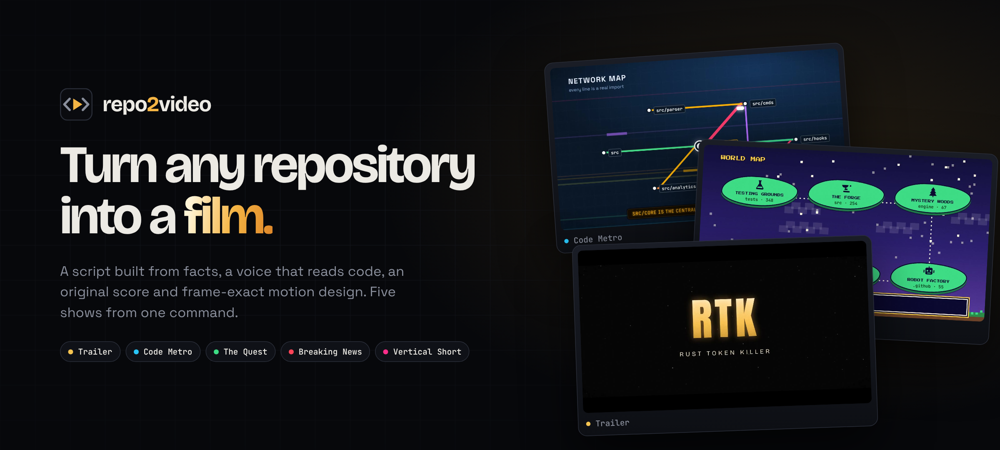
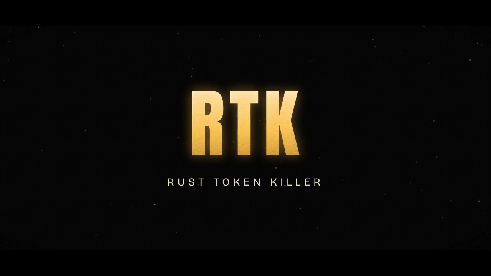
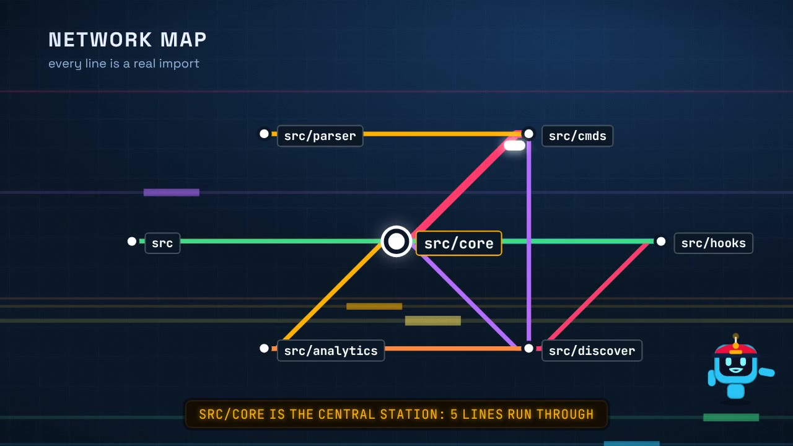
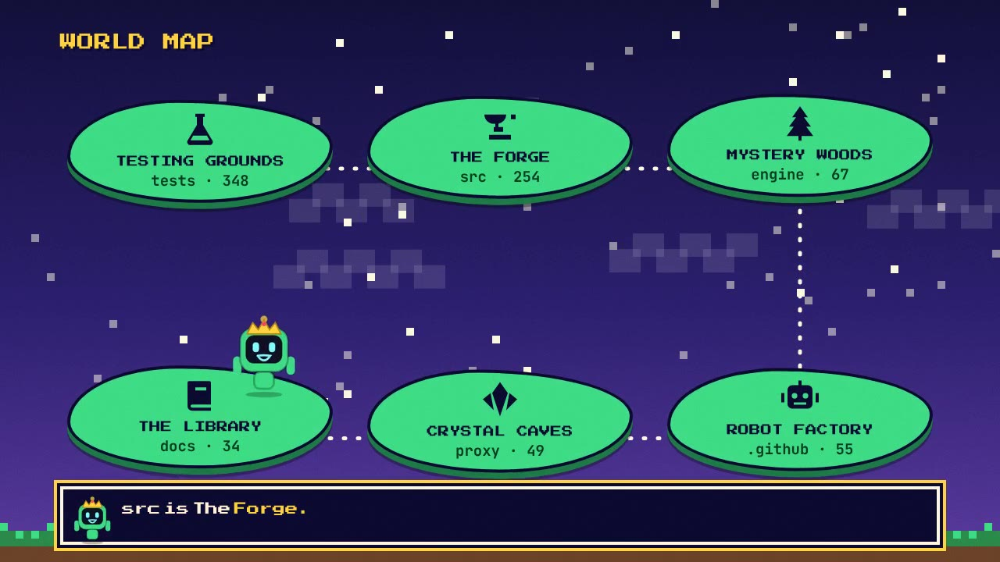
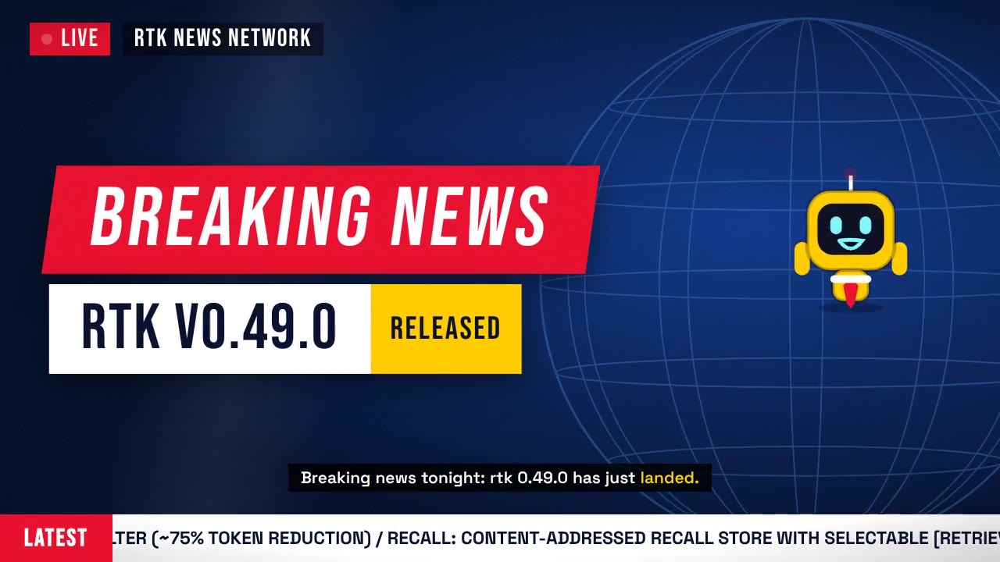
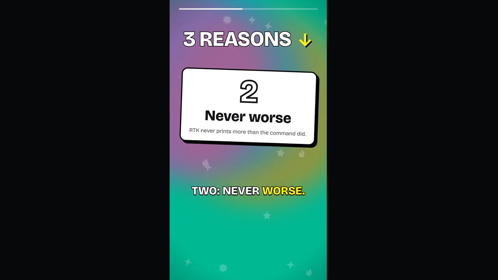
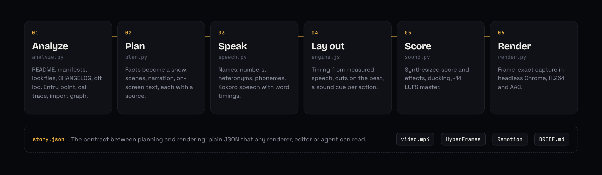

<p align="center">
  <a href="https://burhan-mujahid.github.io/repo2video/">
    
  </a>
</p>

<p align="center">
  <a href="https://github.com/burhan-mujahid/repo2video/actions/workflows/ci.yml"></a>
  <a href="https://github.com/burhan-mujahid/repo2video/releases/tag/v0.1.0"></a>
  
  <a href="LICENSE"></a>
  <a href="https://burhan-mujahid.github.io/repo2video/"></a>
</p>

<p align="center">
  <a href="https://burhan-mujahid.github.io/repo2video/"><b>Website</b></a>
  &nbsp;&middot;&nbsp;
  <a href="https://burhan-mujahid.github.io/repo2video/#formats"><b>Watch the samples</b></a>
  &nbsp;&middot;&nbsp;
  <a href="#quick-start"><b>Quick start</b></a>
  &nbsp;&middot;&nbsp;
  <a href="#reference"><b>Reference</b></a>
  &nbsp;&middot;&nbsp;
  <a href="CHANGELOG.md"><b>Changelog</b></a>
</p>

<br>

**repo2video** reads a code repository and directs a finished video about it. It writes a script built only from
facts in the repository, narrates it with a voice that reads code the way engineers say it, scores it with original
synthesized music, and renders frame-exact motion graphics. One command produces five different shows: a launch
trailer, a ride through the architecture, a contributor's onboarding quest, a release broadcast and a vertical short.

```sh
pip install git+https://github.com/burhan-mujahid/repo2video
repo2video rtk-ai/rtk -m all
```

<p align="center">
  
  <br>
  <sub>Excerpts from the five formats, rendered from <a href="https://github.com/rtk-ai/rtk">rtk-ai/rtk</a> without manual edits. Full videos with sound are on the <a href="https://burhan-mujahid.github.io/repo2video/#formats">website</a> and attached to the <a href="https://github.com/burhan-mujahid/repo2video/releases/tag/v0.1.0">v0.1.0 release</a>.</sub>
</p>

<br>

## Contents

- [Formats](#formats)
- [Quick start](#quick-start)
- [How it works](#how-it-works)
- [The voice](#the-voice)
- [The sound](#the-sound)
- [The scene engine](#the-scene-engine)
- [Integrations](#integrations)
- [Reference](#reference)
- [Project layout](#project-layout)
- [Development](#development)
- [Design principles](#design-principles)
- [Roadmap](#roadmap)
- [Acknowledgements](#acknowledgements)
- [License](#license)

## Formats

Each mode is a complete show with its own script structure, visual language, voice, score, transition style and
caption style. The same facts are told five different ways.

<table>
  <tr>
    <td width="50%" valign="top">
      
      <h3>Trailer</h3>
      <code>-m marketing</code>
      <p>A launch film cut like a movie trailer. A cold open built from the project's pitch, the problem statement glitching over the repository's real entry-point code, a title slam timed to a riser and impact, a feature montage hard-cut on the beat, odometer numbers and closing credits.</p>
    </td>
    <td width="50%" valign="top">
      
      <h3>Code Metro</h3>
      <code>-m engineering</code>
      <p>The architecture as a subway ride. A ticket from the entry point to the last call, the folder tree as a district map, the import graph as a network map, then one station per traced function with the hand-off line lit as the train arrives.</p>
    </td>
  </tr>
  <tr>
    <td width="50%" valign="top">
      
      <h3>The Quest</h3>
      <code>-m onboarding</code>
      <p>A contributor's first day as a video game. Setup commands are objectives that earn XP, folders become zones on a world map, the first file to read is a boss with an HP bar, and the contributing rules arrive on a guild scroll.</p>
    </td>
    <td width="50%" valign="top">
      
      <h3>Breaking News</h3>
      <code>-m release</code>
      <p>A release announcement as a live broadcast. A LIVE bug, a breaking-news slam, headlines flipped in from the CHANGELOG, the numbers from git, a field report from the terminal and a ticker running throughout.</p>
    </td>
  </tr>
  <tr>
    <td width="50%" valign="top">
      
      <h3>Vertical Short</h3>
      <code>-m social</code>
      <p>A 9:16 short under thirty seconds for Shorts, Reels, TikTok and X. A hook in the first second, three reasons on the beat, the headline number, a tap-to-copy install command and large word-by-word captions.</p>
    </td>
    <td width="50%" valign="top">
      <h3>At a glance</h3>
      <table>
        <tr><th>Format</th><th>Voice</th><th>Score</th><th>Transitions</th></tr>
        <tr><td>Trailer</td><td>am_fenrir</td><td>Trailer, 92 BPM</td><td>Flash cut</td></tr>
        <tr><td>Code Metro</td><td>am_michael</td><td>Synthwave, 100 BPM</td><td>Train slide</td></tr>
        <tr><td>The Quest</td><td>af_heart</td><td>Chiptune, 132 BPM</td><td>Iris wipe</td></tr>
        <tr><td>Breaking News</td><td>bf_emma</td><td>News, 116 BPM</td><td>Swoosh band</td></tr>
        <tr><td>Vertical Short</td><td>af_bella</td><td>Trap, 145 BPM</td><td>Punch zoom</td></tr>
      </table>
    </td>
  </tr>
</table>

## Quick start

**Requirements:** Python 3.11 or 3.12 (the pronunciation library, misaki, does not yet support 3.13), [FFmpeg](https://ffmpeg.org), and Chrome or Chromium. On first use, the
Kokoro voice model (about 120 MB) is downloaded from GitHub Releases into `~/.cache/repo2video`.

```sh
pip install git+https://github.com/burhan-mujahid/repo2video
python -m playwright install chromium        # skip if Chrome is installed
```

Render every format for a GitHub repository, or one format for a local folder:

```sh
repo2video rtk-ai/rtk -m all
repo2video . -m engineering -e all           # MP4, HyperFrames, Remotion and BRIEF.md
```

Edit the script before rendering. Names in backticks are read with their symbols.

```sh
repo2video . -m marketing --plan-only -o film
$EDITOR film/story.json
repo2video --story film/story.json
```

Each run writes a folder such as `repo2video-out/rtk-engineering/`:

| File | Contents |
| --- | --- |
| `video.mp4` | The finished film, H.264 and AAC at 30 fps |
| `preview.gif` | The first eight seconds, sized for a README |
| `soundtrack.wav` | Voice, score and sound effects, mixed at 48 kHz |
| `story.json` | The editable script and scene data |
| `facts.json` | Everything the analyzer found, with sources |
| `BRIEF.md` | A director's brief for other video tools |

## How it works

<p align="center">
  
</p>

The pipeline runs in six stages. Facts flow in one direction, and `story.json` sits in the middle as the contract
that every renderer reads.

| Stage | Module | Responsibility |
| --- | --- | --- |
| Analyze | `analyze.py` | Reads the README, manifests, lockfiles, CHANGELOG and git history. Detects the entry point from `package.json`, `pyproject.toml`, `Cargo.toml` or conventions, follows real function calls into other files, and resolves import statements into a module graph for Python, JavaScript and TypeScript, Rust and Go. |
| Plan | `plan.py` | Turns facts into one of five shows. Every line is traceable to a file and line range, a manifest field or a commit range. Lines are varied deterministically per repository. |
| Speak | `speech.py` | Converts written text into how a person says it, then into phonemes, then into audio with per-word timings. |
| Lay out | `engine.js` | Computes scene timing from the measured speech, quantizes cuts to the beat, aligns the drop to a bar, and emits a sound cue for every visible action. |
| Score | `sound.py` | Synthesizes the score and effects, places effects on the engine's cues, ducks the music under the voice and normalizes loudness. |
| Render | `render.py` | Seeks a headless browser frame by frame, encodes with FFmpeg and writes the GIF. |

**Facts, not filler.** Narration and on-screen text come from the repository. Code is shown verbatim with its path
and line range. Numbers come from the README or git. When text has to be shortened for the screen, the narrator only
reads complete clauses, never a truncated sentence. The call trace prefers hand-offs into other files, because a
call that crosses a module boundary explains more architecture than a local helper.

## The voice

Speech engines mispronounce code. repo2video places three layers in front of the
[Kokoro](https://github.com/hexgrad/kokoro) voice model.

**1. Names are read with their symbols.** Paths, files, identifiers, flags, URLs and package names are detected
and verbalized. Punctuation in ordinary prose stays silent, and hyphenated English such as "command-line" is left alone.

| Written | Spoken |
| --- | --- |
| `brief.md` | brief dot M D |
| `main/skills` | main slash skills |
| `register_all()` | register underscore all |
| `src/lib.rs` | source slash lib dot R S |
| `github.com/rtk-ai/rtk` | github dot com slash R T K dash A I slash R T K |
| `--dry-run` | dash dash dry dash run |

**2. Heteronyms follow the sentence.** Part-of-speech tags from [spaCy](https://spacy.io) drive the pronunciation
dictionary in [misaki](https://github.com/hexgrad/misaki), and rule overrides correct what taggers miss.

| Sentence | Pronunciation |
| --- | --- |
| Your app goes live. / Ship it live. | /laɪv/ |
| We live in the terminal. | /lɪv/ |
| Have you read it? | /rɛd/ |
| Read the docs. | /rid/ |
| Export the video. / Update your config. | verb stress: ex-PORT, up-DATE |
| The export is ready. / The update is out. | noun stress: EX-port, UP-date |
| Reset the cache. / Do a full reset. | re-SET / RE-set |

The overrides cover 33 stress pairs (export, import, update, upgrade, reset, record, object, project, present,
progress and others), context rules for live, read, lead, tear, wind and bass, and a lexicon of technical terms
(config, README, JSON, YAML, nginx, npm, CLI, API, LLM and more).

**3. Numbers, units and abbreviations.** `v0.49.0` becomes "version 0 point 49 point 0", `25 ms` becomes
"25 milliseconds", `10x` becomes "10 times", `~75%` becomes "about 75 percent", `#2544` becomes "number 2544", and
`e.g.` becomes "for example".

Word timings from synthesis drive the karaoke captions and the mascot's lip-sync. Each format has its own voice, and
any [Kokoro voice](https://huggingface.co/hexgrad/Kokoro-82M/blob/main/VOICES.md) can be chosen with `--voice`.

## The sound

Every note and effect is synthesized from oscillators, envelopes and filters in NumPy. There are no samples and no
stock music, so each video ships with a score that is entirely its own.

| Score | Tempo | Key | Instrumentation |
| --- | --- | --- | --- |
| Trailer | 92 BPM | D minor | Braams, taiko toms, pulsing bass, riser into an impact on the drop |
| Synthwave | 100 BPM | A minor | Octave bass, arpeggiated saws, gated snare, pads |
| Chiptune | 132 BPM | C major | Square-wave lead, triangle bass, noise drums |
| News | 116 BPM | C minor | Ticking hats, timpani, brass stabs, sting |
| Trap | 145 BPM | C# minor | 808 glides, hi-hat rolls, claps, plucks in half time |

Nineteen effects (whoosh, reverse whoosh, impact, braam, riser, hit, pop, tick, type, ding, chime, coin, level-up, power-up, sting,
glitch, sparkle, click, shutter) are placed on cues emitted by the scene engine, so the soundtrack always matches
the picture.

| Mix stage | Value |
| --- | --- |
| Scene cuts | Quantized to beats; the drop lands on a bar line |
| Voice | Normalized to -16 dB RMS while speaking |
| Music bed | Side-chain ducked, about 14 dB below the voice |
| Master | Soft limiter, about -14 LUFS integrated |

## The scene engine

`engine.js` is a single dependency-free script. Every pixel is a pure function of time: nothing depends on the
previous frame, a clock or unseeded randomness. Any host can seek it to any moment and get the same picture, which is
what makes the HyperFrames and Remotion exports render identically to the built-in renderer.

```js
const video = Repo2Video.createVideo(element, story);
video.render(12.5);          // draw the frame at 12.5 seconds
video.cues;                  // [{ t, sfx, gain, pan }]: every sound the picture makes
video.scenes;                // [{ start, duration, voiceAt }]: timing, from the measured speech
```

- **Composable motion.** An animation registry where one element can rise, bob and punch at the same time.
  Transforms are composed each frame instead of overwriting each other.
- **Camera.** A slow push-in per scene and a beat-synced punch after the drop.
- **Transitions per format.** Flash cuts, train slides, iris wipes, news swooshes and punch zooms.
- **Particles.** Sparks, confetti, pixels, stars and icon bursts replayed from their seed on every frame.
- **Bit, the mascot.** One SVG character in five costumes. It blinks, waves and cheers, and moves its mouth only
  while a word is being spoken.
- **Captions.** Letterbox subtitles, an amber LED station board, an RPG dialog box that types as it speaks,
  closed captions, and large word-by-word captions.
- **Portability.** Bundled fonts and an original 37-glyph SVG icon set, so output does not depend on the fonts or
  emoji installed on a machine.

## Integrations

| Export | Output | Notes |
| --- | --- | --- |
| `mp4` | `video.mp4`, `preview.gif`, `soundtrack.wav` | Built-in renderer: headless Chrome and FFmpeg |
| `hyperframes` | A [HyperFrames](https://github.com/heygen-com/hyperframes) project | Driven by the `hf-seek` protocol; passes `npx hyperframes check` |
| `remotion` | A [Remotion](https://www.remotion.dev) project | `useCurrentFrame` drives the engine; replace components while keeping the story |
| `brief` | `BRIEF.md` | Scenes, verbatim code, evidence and style suggestions for lemo-opuscar, OpenMontage or any agent video skill |

### Claude Code plugin

```sh
claude plugin marketplace add burhan-mujahid/repo2video
claude plugin install repo2video@repo2video
```

Ask for a video in plain language, for example "make a launch trailer for this repo". The skill plans the video,
rewrites the script from the actual code while keeping every claim sourced, renders it, inspects frames, and can hand
the brief to another video skill. For other agents, copy [`plugin/skills/repo2video`](plugin/skills/repo2video) into
their skills folder.

## Reference

### Command line

```
repo2video [TARGET] [-m MODE] [-e EXPORTS] [-o DIR] [--story FILE] [--plan-only] [--voice NAME] [--no-voice]
```

| Option | Default | Description |
| --- | --- | --- |
| `TARGET` | `.` | A local folder, a GitHub URL or `owner/repo`. Remote repositories are cloned with full history and no blobs. |
| `-m`, `--mode` | `marketing` | `marketing`, `engineering`, `onboarding`, `release`, `social` or `all`. |
| `-e`, `--export` | `mp4,brief` | Comma-separated list of `mp4`, `hyperframes`, `remotion`, `brief`, or `all`. |
| `-o`, `--out` | `repo2video-out/<name>-<mode>` | Output folder. |
| `--story` | | Render an edited `story.json` instead of analyzing the repository. |
| `--plan-only` | | Write `facts.json` and `story.json`, render nothing. |
| `--voice` | per mode | Override the Kokoro voice, for example `bf_emma` or `am_michael`. |
| `--no-voice` | | Render captions, music and effects without narration. Skips the model download. |

| Environment variable | Description |
| --- | --- |
| `REPO2VIDEO_CACHE` | Where the voice model is stored. Defaults to `~/.cache/repo2video`. |

### story.json

The story is plain JSON. Every renderer reads it, and it can be edited by hand or by an agent.

```json
{
  "version": 2,
  "mode": "engineering",
  "format": "metro",
  "name": "rtk",
  "width": 1280,
  "height": 720,
  "music": "synthwave",
  "bpm": 100,
  "voice": "am_michael",
  "voice_speed": 1.0,
  "lift": 1,
  "scenes": [
    {
      "type": "stop",
      "symbol": "entry",
      "path": "src/lib.rs",
      "start": 2317,
      "end": 2330,
      "code": "pub fn entry() -> i32 {\n    ...",
      "highlight": [10],
      "evidence": "src/lib.rs:2317-2330",
      "narration": "Next stop: `entry()`, in `src/lib.rs`. Watch this line: it hands off to `register_all()`."
    }
  ]
}
```

| Field | Description |
| --- | --- |
| `format` | `trailer`, `metro`, `quest`, `news` or `reel`. Selects the visual language. |
| `music`, `bpm` | The score and its tempo. Scene durations are quantized to this tempo. |
| `lift` | Index of the scene where the music drops; its start is aligned to a bar line. |
| `scenes[].type` | One of 30 scene types, such as `coldopen`, `reveal`, `network`, `stop`, `objectives` or `headlines`. |
| `scenes[].narration` | What the voice says. Wrap names in backticks to have their symbols read aloud. |
| `scenes[].evidence` | The source of a scene's claims, shown in `BRIEF.md`. |
| `scenes[].audio`, `scenes[].words` | Written by the renderer: measured speech length and per-word timings. |

## Project layout

```
repo2video/
  analyze.py       repository analysis: facts, entry point, call trace, import graph, release notes
  plan.py          the five show formats; facts to story.json
  speech.py        name and number verbalization, heteronyms, phonemes, synthesis, word timings
  sound.py         oscillators, envelopes, filters; five scores, nineteen effects, mixing
  engine.js        the scene engine: motion, camera, transitions, particles, mascot, captions
  fonts.js         bundled fonts, subset to Latin (generated by docs/make_fonts.py)
  render.py        voice, layout, soundtrack, frame capture and encoding
  exports.py       HyperFrames, Remotion and BRIEF.md exports
  cli.py           command-line interface
plugin/            Claude Code plugin and skill
site/              the project website, deployed to GitHub Pages
tests/             self-checks: analysis, formats, pronunciation, timing, exports, rendering
docs/              README assets, the demo GIF builder and the font build
```

## Development

```sh
git clone https://github.com/burhan-mujahid/repo2video && cd repo2video
python -m venv .venv && source .venv/bin/activate
pip install -e ".[dev]"
python -m playwright install chromium

python -m pytest -q                          # the full self-check, including a short render
python -m pyflakes repo2video tests docs
node --check repo2video/engine.js
```

The test suite builds a small fixture repository and checks analysis, all five formats, every pronunciation case
listed above, beat quantization and bar alignment, sound cues, the exports and an end-to-end render. Continuous
integration runs it on Python 3.11 and 3.12. See [CONTRIBUTING.md](CONTRIBUTING.md) for conventions.

**Performance.** A one-minute video takes about three to four minutes on a two-core machine: roughly half for
speech synthesis and half for frame capture and encoding. Output is 1280 by 720 at 30 fps, or 720 by 1280 for the
vertical format.

## Design principles

- **Every claim has a source.** If the repository does not say it, the video does not say it.
- **Deterministic output.** The same story always renders the same frames and the same soundtrack.
- **Picture follows voice.** Scene timing is computed from measured speech, never guessed.
- **Sound follows picture.** Effects are triggered by on-screen events emitted by the engine.
- **Open formats.** The story is plain JSON and the engine is plain JavaScript, so other tools can take over at
  any stage.

## Roadmap

- A GitHub Action that renders the videos on every release and attaches them to the release
- Scripts written by a language model when an API key is configured
- 1080p and 60 fps output
- Additional formats: nature documentary, heist, cooking show
- More languages for the import graph and call trace

## Acknowledgements

- [Kokoro](https://github.com/hexgrad/kokoro) (Apache-2.0) and [kokoro-onnx](https://github.com/thewh1teagle/kokoro-onnx) for speech synthesis
- [misaki](https://github.com/hexgrad/misaki) and [spaCy](https://spacy.io) for grapheme-to-phoneme conversion and tagging
- [Playwright](https://playwright.dev) and [FFmpeg](https://ffmpeg.org) for rendering
- Fonts: Anton, Bebas Neue, Press Start 2P, Space Grotesk, JetBrains Mono and Bricolage Grotesque under the SIL Open Font License 1.1, and Permanent Marker under the Apache License 2.0

## License

Released under the [MIT License](LICENSE). Videos produced with repo2video belong to you.
